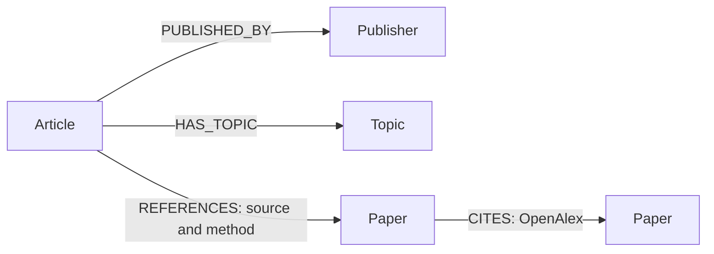
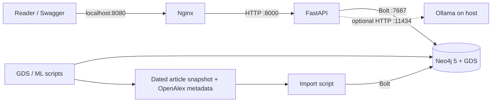

# Traice

**Trace AI news back to its research.** Traice is a Level 2 graph-engineering project that connects AI articles, publishers, topics and linked research papers. Browse an article, follow its evidence and explore related coverage; ask a supported natural-language question and inspect the Cypher and evidence returned.

[](https://github.com/lszefner/traice/actions/workflows/ci.yml)

Traice is an educational demo, not a fact-checker. A linked paper does not verify every claim in an article; a shared feed topic does not mean articles cover the same event. No paper found means none was resolved in this snapshot, not that no paper exists.

## Run the demo

**What you will see:** Traice connects AI news articles to publishers, topics, and research papers. The demo uses a saved dataset, so you do not need to collect data or set up an LLM to explore it. The interface is the API's interactive Swagger page, not the illustrated launch-video interface.

### 1. Start Traice

You need Git, Docker Desktop (or another Docker installation with Compose), and access to this private repository. Start Docker first. The first run downloads the Neo4j, GDS, API, and Nginx images and may take a few minutes.

```bash
git clone https://github.com/lszefner/traice.git
cd traice
cp .env.example .env
make docker-run
docker compose exec -T api python scripts/ingest.py
```

The example `.env` uses a local demo password. You can change `NEO4J_PASSWORD` **before the first startup**; it must be at least eight characters. If you already have a `.env`, keep it instead of copying over it. If the import says a container is not ready, wait for `docker compose ps` to show Neo4j and the API as healthy and retry the import. Re-running the import is safe: it adds or updates records, but does not remove old ones.

### 2. Explore a real example

Open [the example article's evidence](http://localhost:8080/api/articles/1df7478eaeec06c0/evidence). You should see a Stanford Report article about AI benchmarks and its explicitly linked research paper, including source URLs. This link works **on the computer running Traice**, after the import.

For the interactive demo, open [localhost:8080/docs](http://localhost:8080/docs):

1. Open **GET /api/articles**, click **Try it out**, then **Execute** to browse the dataset.
2. Open **GET /api/articles/{article_id}/evidence**, enter `1df7478eaeec06c0`, and execute it to see the article and paper.
3. Try **GET /api/articles/{article_id}/related** with the same ID to see shared-topic connections. A shared topic is not proof that two articles cover the same event.

### 3. Ask a question (optional)

Install and start [Ollama](https://ollama.com/), then download the default model on your computer:

```bash
ollama pull qwen2.5:3b
```

With Ollama running, open **POST /api/ask** in Swagger, click **Try it out**, and submit:

```json
{"question": "Which papers are linked to the fantastic bugs article?"}
```

The response includes the selected query, search term, and graph evidence. This feature needs a reachable Ollama server and downloaded model; the other endpoints work without it. Model interpretation can vary, and an unsupported question may be rejected or misunderstood. If Ollama is unavailable, `/api/ask` returns a service error. See [stack notes](infra/README.md) for configuration and troubleshooting.

### 4. Run the graph analysis (optional)

```bash
docker compose exec -T api python scripts/graph_analysis.py
docker compose exec -T api python scripts/topic_classifier.py data/articles.json
```

The first command runs two GDS algorithms; the second evaluates a simple topic classifier. Their limitations are described in [graph analysis notes](docs/analysis.md). To stop the stack without deleting the graph, run `docker compose down` from the repository directory.

For the assignment checks, install Python 3.11+ and run `make install`, `make lint`, and `make test`. See [Development](#development) for integration tests. The snapshot and its limitations are documented in [data provenance](data/README.md).

## API

| Endpoint | Purpose |
| --- | --- |
| `GET /health` | API process liveness, not database connectivity |
| `GET /api/articles?limit=20&offset=0` | Browse the snapshot |
| `GET /api/articles/{id}/evidence` | Publisher, feed topics and linked papers |
| `GET /api/articles/{id}/related` | Stories connected by shared feed topics |
| `GET /api/papers/{id}/coverage` | Articles with paper-reference edges |
| `GET /api/topics/{id}/connections` | Bounded article–topic–article paths |
| `GET /api/articles/{id}/paths/articles/{other_id}` | Bounded path between two articles |
| `GET /api/articles/{id}/paths/papers/{paper_id}` | Bounded path from an article to a paper |
| `POST /api/ask` | Supported questions to validated queries and structured evidence |

IDs and response examples are available from `/api/articles` and `/docs`. Queries use parameters and explicit limits; the API returns 404 for unknown article, topic or paper IDs and 503 for database or model failures.

## Graph model



Unique IDs are constrained for all four labels. Topics are nodes because shared-topic traversal is a core use case; a string-list property would be simpler but less direct for this traversal. Ratings or generic `RELATED_TO` edges are deliberately absent: feed topic membership and explicit links have different meanings. The stored source and method identify where a paper link was found; OpenAlex provides canonical work metadata and citation links. Article and paper identities are not evidence that the story is accurate.

### Modeling alternatives and AI-generated baseline

A basic AI-generated starting schema for the same prompt might be `(:Article)-[:ABOUT]->(:Topic)` and `(:Article)-[:RELATED_TO]->(:Paper)`, with a publisher string on the article. We chose explicit `Publisher` nodes and separate `HAS_TOPIC`, `REFERENCES` and `CITES` relationships: that supports source comparison, preserves the difference between broad topic labels and paper links, and exposes provenance on each reference. A generic `RELATED_TO` edge would erase those distinctions. The graph does not infer unsupported claim-level evidence or represent link candidates as verified facts.

## Architecture



The snapshot contains 257 articles from ScienceDaily (150), MIT News (81), The Conversation (25), and Stanford Report (1); 16 articles have at least one resolved paper link. It combines feed snapshots collected on 2026-11-02 UTC, OpenAlex metadata, and a manually checked example. Feed-derived links are not the same as a manual verification of the article page. See [data/README.md](data/README.md) for sources, collection rules and limits. The snapshot is a convenience sample, not representative coverage, and redistribution terms need review before wider distribution.

## Graph algorithms and ML

After importing the snapshot:

```sh
docker compose exec api python scripts/graph_analysis.py
docker compose exec api python scripts/topic_classifier.py data/articles.json
```

The first script makes a temporary GDS Article–Topic projection, computes weakly connected component statistics and node similarity, then drops the projection. Similarity represents shared feed topics, not a shared event or source. The second evaluates a simple title-based classifier for recorded single feed topics against a majority-class baseline, with a chronological holdout. It is a learning exercise, not a truth detector. Method and limitations: [graph analysis notes](docs/analysis.md).

## Guardrails and limitations

The LLM chooses one of two fixed, parameterized query templates and a bounded search term. Only exact allowlisted query text is executed, in a read transaction with a timeout and result limit; unsupported, malformed or unsafe outputs are rejected. These controls reduce risk but do not make the model's interpretation infallible. Neo4j Community in this setup uses the configured privileged account, so this is **not** an independent database least-privilege boundary. The model may select the wrong supported template or search phrase, including for an unsupported request. Context and output are capped, so long inputs or truncated output can also be rejected or misunderstood. Review returned evidence and use the links to inspect the original material.

## Development

```sh
make help
make install
make lint
make test
# Against the running stack, export the .env values first:
set -a; source .env; set +a
make test-integration
```

`make run` starts the API locally and requires Neo4j and exported credentials. CI runs lint, unit/API tests with coverage, and Compose configuration validation; integration tests are opt-in and require the stack. `demo.ipynb` explores the snapshot and graph; notebook dependencies and execution steps are described inside it. Query-performance comparisons, public container publication, screenshots, and live-model evaluation should be recorded only after they are actually completed.

## API container image

The application-only image publishing workflow excludes the separately sourced data snapshot. Registry publication, package visibility and anonymous pull must be verified before the assignment’s public-image criterion can be claimed. See [image publishing](infra/PUBLIC-IMAGE.md).

## Contributions

Use feature branches, meaningful commits and substantive PRs with review. The assignment calls for balanced contributions and at least one substantial merged PR per team member. Do not manufacture commits or misrepresent authorship. The checked-in [assignment](ASSIGNMENT.md) is the authoritative rubric.
