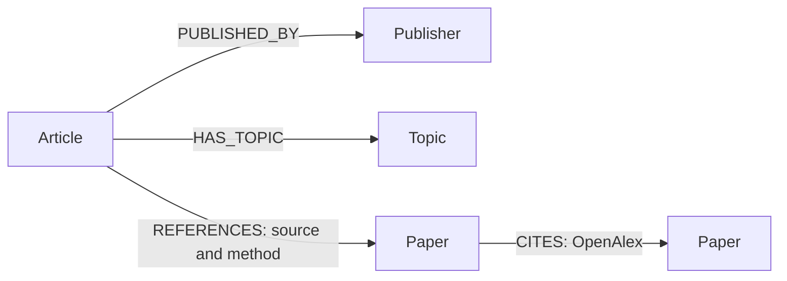
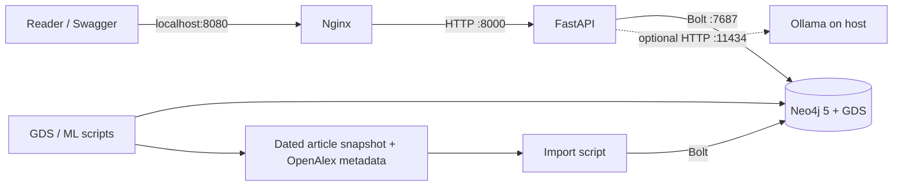

# Traice

**Trace AI news back to its research.** Traice is a Level 2 graph-engineering project that connects AI articles, publishers, topics and linked research papers. Browse an article, follow its evidence and explore related coverage; ask a supported natural-language question and inspect the Cypher and evidence returned.

[](https://github.com/lszefner/moviegraph/actions/workflows/ci.yml)

Traice is an educational demo, not a fact-checker. A linked paper does not verify every claim in an article; a shared feed topic does not mean articles cover the same event. No paper found means none was resolved in this snapshot, not that no paper exists.

## Quick start

Requires Docker with Compose and internet access on first startup. Neo4j downloads the GDS plugin; the local model is optional for the non-AI endpoints. Create a local environment file and replace the example password (at least eight characters):

```sh
cp .env.example .env
# Edit NEO4J_PASSWORD in .env, then:
make docker-run
docker compose ps
docker compose exec api python scripts/ingest.py
```

Open [Swagger](http://localhost:8080/docs), or Neo4j Browser at [localhost:7474](http://localhost:7474). A persistent database volume retains graph data when the stack stops. Import uses `MERGE`: rerunning updates and adds records but does not remove stale ones. To start from a clean snapshot, deliberately remove the project's data volume only after deciding the existing data can be discarded. See [data provenance](data/README.md) and [stack notes](infra/README.md).

For the natural-language feature, install and start [Ollama](https://ollama.com/), run `ollama pull qwen2.5:3b` on the host and use the model settings in `.env`. Ollama is not a Compose service. A reachable local server and downloaded model are required; a missing model returns a service error. Do not expose the demo stack to the public.

## Demo: what research is behind an AI story?

1. Open `/docs` and call `GET /api/articles` to browse articles. For a known example, call `GET /api/articles/1df7478eaeec06c0/evidence` to see the Stanford benchmark article and its linked paper.
2. Call `GET /api/articles/{article_id}/related` for stories connected by shared feed topics, and `GET /api/papers/{paper_id}/coverage` for articles referencing a particular paper. An empty result is a valid outcome for sparse data.
3. With Ollama running, call `POST /api/ask` with `{"question":"Which articles with linked papers are about artificial intelligence?"}`. Inspect the returned query, parameters and evidence. The model selects one of two fixed query templates; it cannot compose arbitrary Cypher. Model output may vary or be rejected.
4. Run `make test` to demonstrate rejection of unsupported or unsafe generated queries. This is an automated guardrail test; a successful live model request must be demonstrated separately.
5. Run the graph and ML scripts below and inspect their actual output. Explain the coverage and sampling limitations rather than interpreting similarity as truth.

## API

| Endpoint | Purpose |
| --- | --- |
| `GET /health` | API process liveness, not database connectivity |
| `GET /api/articles?limit=20&offset=0` | Browse the snapshot |
| `GET /api/articles/{id}/evidence` | Publisher, feed topics and linked papers |
| `GET /api/articles/{id}/related` | Stories connected by shared feed topics |
| `GET /api/papers/{id}/coverage` | Articles with paper-reference edges |
| `GET /api/topics/{id}/connections` | Bounded article–topic–article paths |
| `GET /api/articles/{id}/paths/articles/{other_id}` | Bounded path between two articles |
| `GET /api/articles/{id}/paths/papers/{paper_id}` | Bounded path from an article to a paper |
| `POST /api/ask` | Supported questions to validated queries and structured evidence |

IDs and response examples are available from `/api/articles` and `/docs`. Queries use parameters and explicit limits; the API returns 404 for unknown article, topic or paper IDs and 503 for database or model failures.

## Graph model



Unique IDs are constrained for all four labels. Topics are nodes because shared-topic traversal is a core use case; a string-list property would be simpler but less direct for this traversal. Ratings or generic `RELATED_TO` edges are deliberately absent: feed topic membership and explicit links have different meanings. The stored source and method identify where a paper link was found; OpenAlex provides canonical work metadata and citation links. Article and paper identities are not evidence that the story is accurate.

### Modeling alternatives and AI-generated baseline

A basic AI-generated starting schema for the same prompt might be `(:Article)-[:ABOUT]->(:Topic)` and `(:Article)-[:RELATED_TO]->(:Paper)`, with a publisher string on the article. We chose explicit `Publisher` nodes and separate `HAS_TOPIC`, `REFERENCES` and `CITES` relationships: that supports source comparison, preserves the difference between broad topic labels and paper links, and exposes provenance on each reference. A generic `RELATED_TO` edge would erase those distinctions. The graph does not infer unsupported claim-level evidence or represent link candidates as verified facts.

## Architecture



The snapshot contains 257 articles from ScienceDaily (150), MIT News (81), The Conversation (25), and Stanford Report (1); 16 articles have at least one resolved paper link. It combines feed snapshots collected on 2026-11-02 UTC, OpenAlex metadata, and a manually checked example. Feed-derived links are not the same as a manual verification of the article page. See [data/README.md](data/README.md) for sources, collection rules and limits. The snapshot is a convenience sample, not representative coverage, and redistribution terms need review before wider distribution.

## Graph algorithms and ML

After importing the snapshot:

```sh
docker compose exec api python scripts/graph_analysis.py
docker compose exec api python scripts/topic_classifier.py data/articles.json
```

The first script makes a temporary GDS Article–Topic projection, computes weakly connected component statistics and node similarity, then drops the projection. Similarity represents shared feed topics, not a shared event or source. The second evaluates a simple title-based classifier for recorded single feed topics against a majority-class baseline, with a chronological holdout. It is a learning exercise, not a truth detector. Method and limitations: [graph analysis notes](docs/analysis.md).

## Guardrails and limitations

The LLM chooses one of two fixed, parameterized query templates and a bounded search term. Only exact allowlisted query text is executed, in a read transaction with a timeout and result limit; unsupported, malformed or unsafe outputs are rejected. These controls reduce risk but do not make the model's interpretation infallible. Neo4j Community in this setup uses the configured privileged account, so this is **not** an independent database least-privilege boundary. The model may select the wrong supported template or search phrase. Review returned evidence and use the links to inspect the original material.

## Development

```sh
make help
make install
make lint
make test
# Against the running stack, export the .env values first:
set -a; source .env; set +a
make test-integration
```

`make run` starts the API locally and requires Neo4j and exported credentials. CI runs lint, unit/API tests with coverage, and Compose configuration validation; integration tests are opt-in and require the stack. `demo.ipynb` explores the snapshot and graph; notebook dependencies and execution steps are described inside it. Query-performance comparisons, public container publication, screenshots, and live-model evaluation should be recorded only after they are actually completed.

## Contributions

Use feature branches, meaningful commits and substantive PRs with review. The assignment calls for balanced contributions and at least one substantial merged PR per team member. Do not manufacture commits or misrepresent authorship. The checked-in [assignment](ASSIGNMENT.md) is the authoritative rubric.
